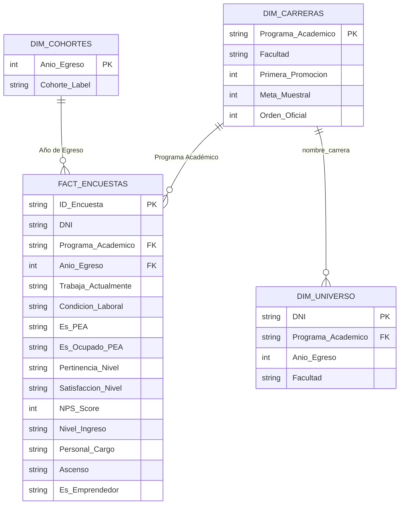

# Plan de Migración Integral a Power BI: Encuesta de Empleabilidad 2026

Este plan detalla la migración completa del dashboard web hacia **Microsoft Power BI**, permitiendo editar textos, modificar gráficos, reconfigurar tipos visuales y actualizar datos de manera 100% interactiva sin tocar código HTML/JavaScript.

---

## 1. Arquitectura del Modelo de Datos (Esquema Estrella)

Para que Power BI funcione con máxima fluidez y escalabilidad, desacoplaremos la lógica en un modelo analítico estrella:

---

## 2. Entregables y Componentes

### Componente 1: Pipeline ETL en Python
- **Archivo:** [`tools/export_to_powerbi.py`](file:///home/sjaquer/Proyects/sanbox-personal/dashboard_egresados_ivette/tools/export_to_powerbi.py)
- **Función:**
  - Lee y unifica `data/respuestas_encuestas.xlsx`, `data/respuestas_encuestas_2025.csv` y `data/universo.xlsx`.
  - Limpia anomalías de caracteres (`_x0000_`, tildes, saltos de línea).
  - Normaliza y clasifica automáticamente las columnas clave:
    - `Es_PEA` (Ocupado / Buscador activo / No PEA inactivo).
    - `Pertinencia_Normalizada` (Totalmente / Parcialmente / No afín).
    - `Rango_Ingreso_Normalizado` (Hasta S/ 1,500 / S/ 1,501 - 3,000 / Más de S/ 3,000 / No declara).
  - Exporta en carpeta `data/powerbi/`:
    - `Fact_Encuestas.csv`
    - `Dim_Carreras.csv`
    - `Dim_Universo.csv`
    - `Dim_Cohortes.csv`

### Componente 2: Tema Corporativo Oficial Wiener para Power BI
- **Archivo:** [`powerbi/wiener_theme.json`](file:///home/sjaquer/Proyects/sanbox-personal/dashboard_egresados_ivette/powerbi/wiener_theme.json)
- **Función:**
  - Define la paleta de colores institucional (`#0A1B44`, `#188BF6`, `#0DBBB9`, `#F5BD38`, `#9EC5FE`, `#10B981`, `#EF4444`).
  - Configura fuentes tipográficas (Inter/Segoe UI), tamaños de títulos, etiquetas de datos y bordes redondeados (10px) en todas las tarjetas de Power BI automáticamente.

### Componente 3: Catálogo Exhaustivo de Medidas DAX
- **Archivo:** [`powerbi/medidas_dax.dax`](file:///home/sjaquer/Proyects/sanbox-personal/dashboard_egresados_ivette/powerbi/medidas_dax.dax)
- **Medidas implementadas:**
  1. **Muestreo:** `[Total Encuestas Válidas]`, `[Total Universo]`, `[Tasa Cobertura]`, `[Avance Meta]`, `[Margen Error PEA]`.
  2. **Empleabilidad y PEA:** `[Tasa Ocupación PEA]`, `[Total Ocupados PEA]`, `[Total PEA]`, `[Tasa Desempleo]`, `[Tasa Trabaja General]`.
  3. **Calidad Laboral:** `[Tasa Pertinencia Laboral]`, `[Tasa Satisfacción Laboral]`, `[Tasa Personal a Cargo]`, `[Tasa Ascensos]`, `[Tasa Ingreso Mayor 3000]`.
  4. **NPS:** `[Total Promotores]`, `[Total Detractores]`, `[NPS Score]`.
  5. **Emprendimiento:** `[Total Emprendedores]`, `[Tasa Formalizados]`, `[Tasa Afines]`.

### Componente 4: Guía de Montaje y Construcción Visual Paso a Paso
- **Archivo:** [`GUIA_MIGRACION_POWERBI.md`](file:///home/sjaquer/Proyects/sanbox-personal/dashboard_egresados_ivette/GUIA_MIGRACION_POWERBI.md)
- **Estructura detallada para armar cada página en Power BI:**
  - **Página 1: Resumen Ejecutivo** (Réplica exacta de la imagen oficial con 6 tarjetas KPI y 5 visuales coordinados).
  - **Página 2: Situación Laboral** (Desglose PEA, Ocupación por cohorte, Dot Plot por carrera).
  - **Página 3: Empleabilidad y Calidad** (Pertinencia formativa, distribución de ingresos, semáforos por carrera).
  - **Página 4: Emprendimientos** (Tasa de formalización, afinidad con profesión, tipo de negocio).
  - **Página 5: Análisis Evolutivo** (Comparativas temporales y tendencias 2021 a 2025).
  - **Página 6: NPS y Cualitativo** (Distribución de promotores, neutros, detractores y nubes de texto/categorías).

---

## 3. Plan de Verificación

1. **Ejecución del pipeline ETL:**
   - Correr `python3 tools/export_to_powerbi.py` y verificar que genere los 4 archivos CSV con codificación UTF-8 sin errores de lectura.
2. **Validación de consistencia de cifras:**
   - Comparar los totales calculados por el ETL contra los valores oficiales (`2,984` encuestas, `2,432` ocupados, `81.5%` trabaja, `95.0%` tasa PEA, `90.6%` pertinencia, `+39.6` NPS).
3. **Validación del tema JSON:**
   - Comprobar que el archivo JSON de tema cumpla con la especificación de temas de Power BI.
